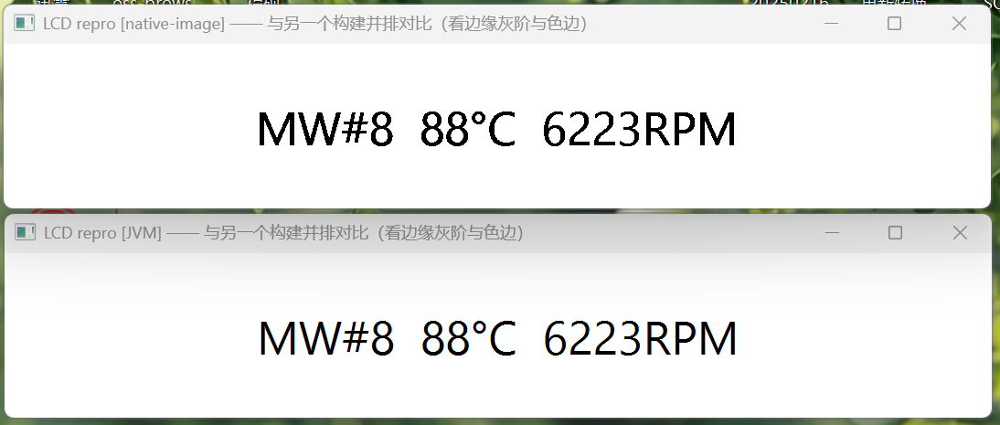

**English** | [简体中文](README.zh-CN.md)

# JavaFX LCD Sub-pixel Text Composition Degradation — Minimal Reproduction (GraalVM native-image)

This repository is a **minimal reproducible project** for the rendering problem described below: the very
same JavaFX code renders LCD sub-pixel text correctly when run as a `JVM Jar`, but once compiled with
GraalVM `native-image` the coverage of the three color channels is collapsed into a single scalar and
binarized.

The repository contains only the sources, configuration and documentation needed to reproduce the problem;
it contains no application code.



## 1. Problem description

### 1.1 Observation data

On the same Windows 11 x64 machine (Intel UHD, display scale 1.5x) the same program is run in both ways and
prints the per-channel coverage of the "black on white, 14px" sample:

| Run mode | `per-channel ink` | Result |
| --- | --- | --- |
| `JVM Jar` (`java -jar`) | `73135 / 73618 / 73245`, `collapsed=false` | the three channels differ; composition is correct |
| `native-image` | `105825 / 105825 / 105825`, `collapsed=true` | the three channels are identical; the problem reproduces |

Two remarks:

* the values on the `JVM Jar` side depend on the runtime environment; between machines they differ by about ±0.06%;
* the output on the `native-image` side is **bit-for-bit identical** across environments — binarization has flattened the differences.

### 1.2 Behaviour model

* expected: `out_c = mix(bg_c, fg_c, m_c)`, i.e. each color channel uses its own coverage `m_c`;
* actual: `out_c = mix(bg, fg, s)`, i.e. all three channels share a single scalar `s`, and `s` is binarized.

This model is derived from the observation data above; the derivation and the items ruled out are given in section 7.

## 2. Environment requirements

| Item | Requirement |
| --- | --- |
| Operating system | Windows x64 |
| Visual assessment | needs a real GPU with working ClearType; CI machines have no GPU (D3D runs through WARP) and are not suitable for judging visual appearance |
| JDK / GraalVM | GraalVM for JDK 17 / 20 / 21 / 22 / 23 / 24 / 25 (covered by the version matrix) |
| JavaFX | the version matching the JDK; plus one cell with JDK 25 + JavaFX 27 |
| Build tool | Maven |

## 3. Quick start

### 3.1 Using a release bundle (recommended)

```bat
Dist\Update.cmd            :: lists every bundle in the latest release; enter a number when prompted
Dist\Update.cmd jdk23      :: select by keyword (25.0.4 and similar also work)
Dist\Update.cmd stable     :: stable releases only
```

After downloading and extracting, double-click the two entry scripts in the same directory to compare:

```bat
Dist\RunNativeImage.cmd    :: native image (lcd-repro.exe)
Dist\RunJVMJar.cmd         :: JVM version (lcd-repro.jar)
```

Both scripts only run the program **located in their own directory** (resolved via `%~dp0`), so they can
never pick up a same-named program from `PATH`; if the program is missing they report it explicitly.

### 3.2 Building from source

```bat
mvn -B -ntp package -Dmaven.compiler.release=25 -Djavafx.version=25.0.4
mvn -B -ntp dependency:copy-dependencies -DoutputDirectory=target/lib

:: the `JVM Jar` side (should print collapsed=false / OK)
java -cp "target/classes;target/lib/*" LcdSubpixelRepro

:: the native image side (should print collapsed=true, i.e. the problem reproduces)
native-image -cp "target/classes;target/lib/*" -o target/lcd-repro LcdSubpixelRepro
target\lcd-repro.exe
```

In CI, `classes` and the dependencies are additionally merged into a self-contained `lcd-repro.jar`
(see the `BuildFatJar` step of the workflow); the JVM version inside a release bundle is that fat jar.

## 4. Criterion

With black text on a white background, correct LCD sub-pixel composition necessarily satisfies
`out_c = 1 − m_c`, therefore **the coverage of the three channels R/G/B can never be equal**.

| Run mode | Expected output |
| --- | --- |
| `JVM Jar` | `per-channel ink = <three different values>   collapsed=false` → `OK` |
| `native-image` | `per-channel ink = <three identical values>   collapsed=true` → `*** BUG ***` |

* By default the program **opens a window**: each entry script starts one window for side-by-side visual
  comparison, and the criterion numbers are printed to the console at the same time;
* when only the numbers are needed (scripting / CI), add `--headless`, e.g. `lcd-repro.exe --headless`;
* note: `-Dprism.lcdtext=false` selects the greyscale rendering path, which works around the problem; it is
  not what this reproduction observes.

## 5. Version matrix and release artifacts

CI builds each of the following 8 combinations once and runs both criteria above:

| # | GraalVM for JDK | JavaFX | # | GraalVM for JDK | JavaFX |
| --- | --- | --- | --- | --- | --- |
| 1 | 17 | 17.0.20 | 5 | 23 | 23.0.2 |
| 2 | 20 | 20.0.2 | 6 | 24 | 24.0.2 |
| 3 | 21 | 21.0.12 | 7 | 25 | 25.0.4 |
| 4 | 22 | 22.0.2 | 8 | 25 | 27 |

Workflow (`.github/workflows/LcdSubpixelReproMatrix.yml`):

* **Trigger**: runs automatically after a PR is merged into `dev` or `main`; it can also be started manually
  from the Actions page (a PR number may be entered manually for naming, see below);
* **Artifacts**: the build output of every cell is packaged and published to Releases (pre-release):

| Item | Rule |
| --- | --- |
| Release name (also used as the tag) | `V<Maven version>.<revision>-LCDSubpixelRepro` |
| Revision | the number of the PR that triggered the build, zero-padded to 5 digits (PR #1 → `00001`); a timestamp `yyyy.MMdd.HHmm` when triggered manually without a number |
| Asset name | `lcd-subpixel-repro-V<Maven version>.<revision>-jdk<JDK major>-openjfx<OpenJFX version>.zip` |

Every bundle contains (flat structure; after extraction the files sit in the `Dist` directory):

```
lcd-repro.exe            native image
lcd-repro.jar            JVM version (self-contained fat jar)
RunNativeImage.cmd       double-click to run the native image
RunJVMJar.cmd            double-click to run the JVM version
RESULT.txt               the raw criterion numbers from the build machine
build-report/lcd-repro-build-report.html   native-image build report (JDK 23 and later cells)
```

Note: the GraalVM used by the JDK 17 cell (and by the group of older versions it belongs to) does not offer
`--emit build-report`, so that file is absent from its bundle; the criterion and the reproduction are
unaffected.

CI build machines have no GPU and D3D runs through WARP (a software implementation, still the real D3D
backend). The CI numbers are therefore sufficient to decide **whether the problem reproduces**, but visual
and pixel-level conclusions should still be drawn on a real machine.

## 6. Repository layout

```text
.
├── .github
│   ├── workflows
│   │   └── LcdSubpixelReproMatrix.yml           8-cell version matrix build and release (triggered by PR merge)
│   └── dependabot.yml                           dependency updates (Maven + GitHub Actions, monthly, PRs target `dev`)
├── Dist
│   ├── README.md                                usage notes for the `Dist` directory
│   ├── RunJVMJar.cmd                            double-click: run `lcd-repro.jar` from **this directory** (JVM version)
│   ├── RunNativeImage.cmd                       double-click: run `lcd-repro.exe` from **this directory** (native image)
│   ├── Update.cmd                               double-click: download the latest bundle into this directory (list all / select by keyword / `stable`)
│   └── Update.ps1                               the actual logic of `Update.cmd`: query releases → pick a bundle → download → extract
├── src
│   └── main
│       ├── java
│       │   └── LcdSubpixelRepro.java            the reproducer (44 lines of effective code): LCD text → snapshot → count per-channel coverage
│       └── resources
│           └── META-INF
│               └── native-image
│                   ├── jni-config.json          native-image JNI metadata (used by JavaFX)
│                   ├── native-image.properties  native-image build arguments (`--no-fallback` + JavaFX run-time initialization)
│                   ├── reflect-config.json      native-image reflection metadata (used by JavaFX)
│                   └── resource-config.json     native-image resource metadata (used by JavaFX)
├── .gitignore                                   ignores build output and common project files (Java template + `target/`, `build/`)
├── LICENSE                                      full GNU GPL v3 license text
├── pom.xml                                      minimal Maven project, depending only on JavaFX base / graphics / controls
├── README.md                                    English README (default, this file)
└── README.zh-CN.md                              Chinese README
```

## 7. Causes ruled out

All of the following were verified to be **identical in both builds** and therefore do not cause this problem:

* DirectWrite glyph mask: byte-for-byte identical in both builds;
* texture upload: the native call into the same `prism_d3d.dll`;
* the shader `.obj` files and the `*_Loader` constant tables;
* geometry and line spacing of `MaskData` / `GlyphCache`;
* all 44 `PrismSettings` fields and the class initialization policy (the audit reports run-time initialization throughout);
* the runtime environment (two processes on the same machine) and the compiler optimization level (`-Ob`).

## 8. Dependency maintenance

Dependabot checks once a month, covering the Maven dependencies and the GitHub Actions used by the workflow.
Its PRs target the `dev` branch directly (configuration in `.github/dependabot.yml`). A check can also be
triggered manually at any time with "Check for updates" on the repository's Dependabot page.

## 9. License

This project is licensed under the **GNU General Public License v3.0**; see [`LICENSE`](LICENSE) for the
full text.
